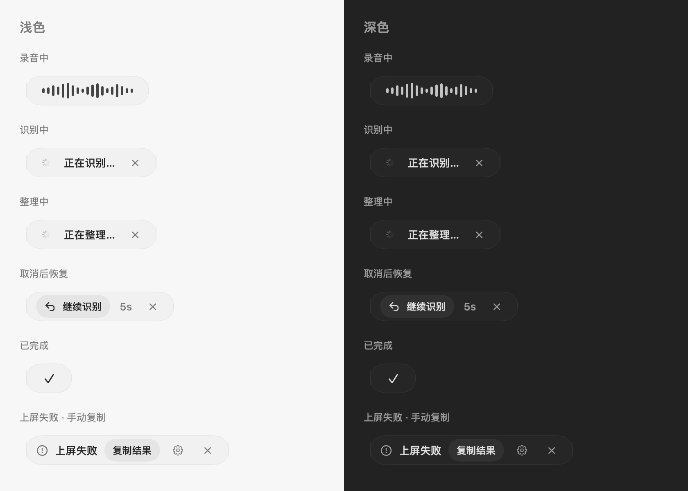
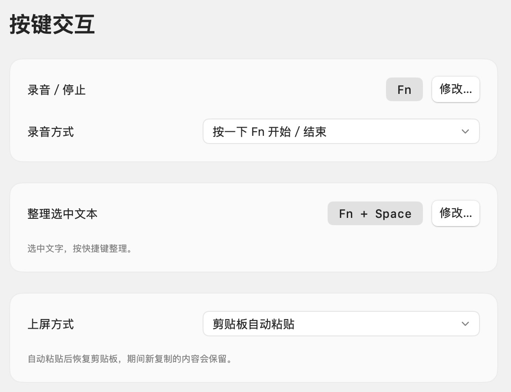
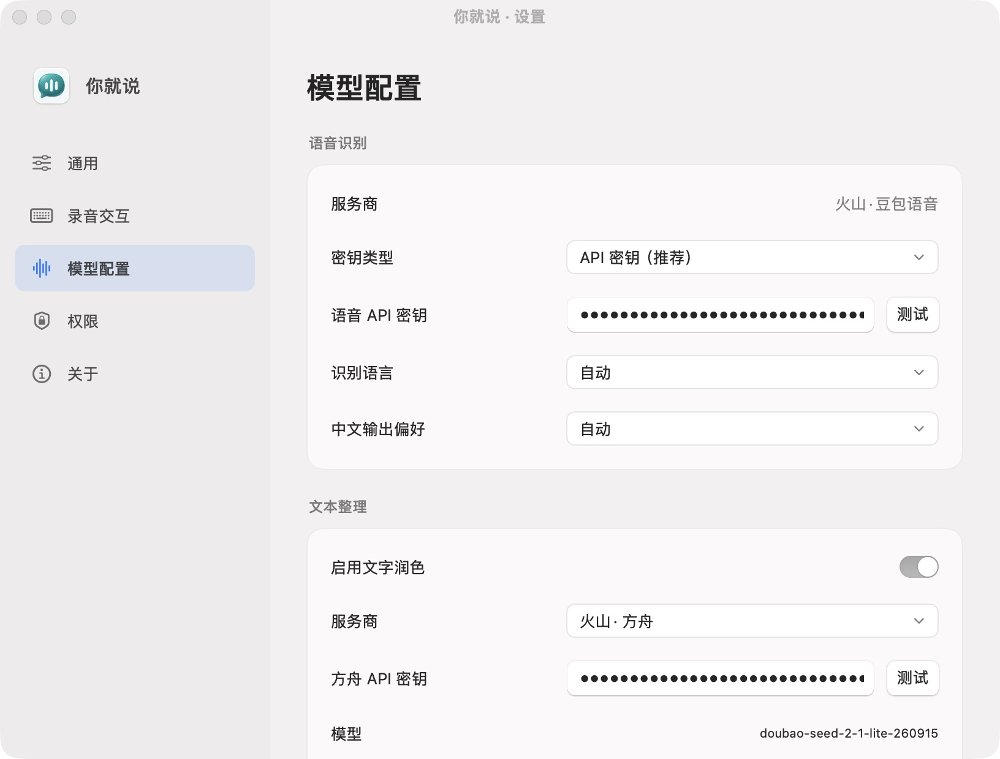
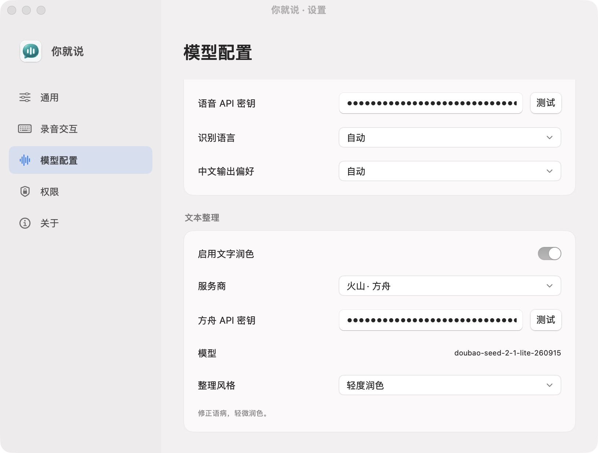

<p align="center">
  <picture>
    <source media="(prefers-color-scheme: dark)" srcset="website/assets/app-icon-dark.png" />
    
  </picture>
</p>

<h1 align="center">你就说 · YouJustSay</h1>

<p align="center"><strong>想说的，直接变成写好的。</strong></p>

<p align="center">
  按一下 Fn，开口说话，再按一下，文字就到输入框。<br />
  选中文字，按 Fn + 空格，也能直接整理已有表达。
</p>

<p align="center"><strong>免费开源 · 无应用订阅 · 保留你习惯的输入法</strong></p>

<p align="center">
  <a href="https://github.com/nufegia/YouJustSay/releases/latest"><strong>下载 Mac 版 →</strong></a>
  &nbsp; · &nbsp;
  <a href="https://nufegia.github.io/YouJustSay/">产品官网</a>
  &nbsp; · &nbsp;
  <a href="docs/INSTALL.zh-CN.md">安装指南</a>
  &nbsp; · &nbsp;
  <a href="#界面预览">看看界面</a>
</p>

<p align="center"><sub>macOS 14+ · 当前安装包适用于 Apple 芯片 · 自备 API 密钥</sub></p>

| 不多交一份月租 | 不改变输入习惯 | 把口述输入做好 |
| :---: | :---: | :---: |
| 应用免费，自备密钥，API 按量付费 | 五笔、RIME 照用，Fn 随时唤起语音输入 | 原生 macOS 浮条，识别后按需整理文字 |

**随口说出的念头，也能好好留下来。**

> **你说：**“嗯，突然想去海边，什么也不安排，就走走。”<br />
> **整理后：**“突然想去海边。什么也不安排，就走走。”

<sub>以上为文字整理示例，实际结果随模型与整理风格而异；也可关闭整理，直接使用识别结果。</sub>

应用免费开源，无需注册应用账号；语音识别与文字整理使用你自己的 API 密钥，费用由服务商按使用量收取。

## 1.0.10：声音与文字，各有你的选择

**新增 OpenAI，保留豆包与方舟。语音识别、文字整理，服务和模型分别选。**

- **独立配置**：语音与文字使用各自的 API Key，可以混搭，例如豆包识别 + OpenAI 整理。
- **模型自由选择**：OpenAI 与方舟文字整理均支持预设和自定义模型 ID；切换后保留自定义配置。
- **升级照旧顺手**：旧用户保留原有服务，新安装默认 OpenAI；优化密钥输入、菜单状态与授权流程，快捷键被系统暂停时给出提示。

[下载 1.0.10](https://github.com/nufegia/YouJustSay/releases/tag/v1.0.10) · [完整更新说明](docs/releases/1.0.10.md)

当前为停止录音后识别；边说边显示文字仍在计划中。应用免费，API 费用由所选服务商收取。

## 为什么选择你就说

**如果你已经有顺手的输入法，只想给 Mac 加上语音输入，它就是为这种需求做的。**

| 你在意的事 | 你就说的选择 |
| --- | --- |
| **偶尔用，也不想每月付订阅费** | 应用免费开源，不收订阅费；识别和整理使用自己的 API 密钥，服务费用按量计算。 |
| **输入法已经用顺手了** | 保留五笔、RIME 等现有输入法，需要时按 Fn 说话；支持自动粘贴、直接键入或仅复制。 |
| **想让口语变清楚，又想保留自己的表达** | 基础整理、轻度润色、高度结构化三种风格可选，也能关闭整理，直接使用识别结果。 |
| **想自己选择文字整理模型** | 内置 OpenAI、方舟及自定义兼容接口；预设与自定义模型均可选择，语音和文字分别配置密钥。 |
| **喜欢 Mac 上简单、顺手的工具** | 原生 macOS 界面，浅色／深色浮条；Fn 开始或结束、按住说话、Esc 取消，专注口述输入。 |

首次使用选择豆包语音或 OpenAI 并填写对应密钥；启用文字整理时，再配置整理服务。适合愿意花几分钟配置、希望自己掌握服务选择和用量的人。

## 界面预览

### 浮条状态

录音、识别、整理、取消后恢复与完成，浅色和深色一览。浮条由当前原生组件渲染，波形为示例。



### 按键交互与选中文字整理

按 Fn 开始／结束，或按住说话；选中文字后按 Fn + 空格进行整理。两组快捷键均可自定义，共用自动粘贴、模拟键入、仅复制三种上屏方式。



### 自带模型密钥

语音识别可选豆包或 OpenAI；文字整理可选方舟、OpenAI 或自定义兼容接口。下方为旧版界面参考，新版已加入独立模型与密钥配置。



### 三种整理风格

基础整理保留原话，轻度润色修正语病，高度结构化去除口水词和冗余表达、优化书面语，并按需分段归类和列点。也可关闭整理。



## 下载与安装

[下载最新正式版](https://github.com/nufegia/YouJustSay/releases/latest) · [完整安装说明](docs/INSTALL.zh-CN.md)

下载 DMG 后，将应用拖入「应用程序」。从 1.0.7 起，应用已使用 Apple 颁发的 Developer ID 证书签名并通过苹果公证，可以正常双击打开。首次运行仍需按系统提示确认打开，并授权麦克风和辅助功能。

从 1.0.3 开始，可在「关于」页或应用菜单中检查更新。更新通过 GitHub Releases 分发，安装前验证更新签名并请求确认；也可关闭自动检查。1.0.2 用户需先手动安装新版本一次。[更新与发布说明](docs/UPDATES.zh-CN.md)

## 支持的服务商

| 用途 | 服务商 | 配置 |
| --- | --- | --- |
| 语音识别 | OpenAI | `gpt-transcribe`，停止录音后识别；独立语音 API Key。 |
| 语音识别 | [火山·豆包语音](https://www.volcengine.com/docs/6561/1631584?lang=zh) | 录音文件极速版；API 密钥或 App ID + Access Token。 |
| 文字整理 | OpenAI | Responses API；预设或自定义模型，独立文字 API Key。 |
| 文字整理 | [火山·方舟](https://docs.volcengine.com/docs/ark?lang=zh) | 方舟 API 密钥，默认豆包模型，也可填写自定义模型或接入点 ID。 |
| 文字整理 | [深度求索（DeepSeek）](https://api-docs.deepseek.com/)等 OpenAI 兼容服务 | 选择「自定义」，填写 HTTPS 接口地址、模型和密钥，使用兼容的 Chat Completions 模型。 |

## 开始使用

1. 打开 `YouJustSay.app`，授权麦克风和辅助功能。
2. 选择豆包或 OpenAI 语音并填写密钥；启用整理时配置方舟、OpenAI 或自定义服务。分别点击「测试」验证。
3. 按 Fn 说话，再按 Fn 结束，文字输入到所选位置。
4. 在可编辑文本框中选中文字，按 `Fn + 空格` 使用「整理选中文本」，整理结果遵循「按键交互」中的上屏方式：自动粘贴或模拟键入会覆盖原选区，仅复制则保留原文并将结果复制到剪贴板。此功能使用模型配置中的整理服务和风格，即使关闭录音自动整理也能使用。

在「按键交互」中可分别自定义语音输入和整理选中文本的快捷键，不能设为相同组合。整理完成前请保持原输入框和选区；如果发生变化，应用会保留当前文字，并提供复制结果。目标应用需要支持辅助功能读取文本选区。

按 Esc 取消；识别或整理取消后，5 秒内可恢复。按 `⌃⌥⌘S` 打开设置。

## 数据与隐私

密钥存于本机钥匙串。音频、识别文字及主动选择整理的文本由所选服务处理，不保存文字历史，临时录音正常结束后删除。

## 从源码构建

需要 macOS 14 或更新版本，以及支持 Swift 6 和 `.icon` 图标编译的 Xcode 工具链（当前发行包使用 Xcode 27 构建）。

```sh
swift test
./script/build_and_run.sh --release
./script/package_release.sh
```

## 许可证

采用 [MIT 许可证](LICENSE)。

### OpenAI API 设置

在「模型配置」中，OpenAI 排在语音识别和文本整理服务商列表首位，并作为新安装时的默认服务商；旧版升级保留豆包语音和原文字服务。两项分别填写 API Key，独立保存在 macOS 钥匙串；模型独立选择，不改变已有豆包、方舟或自定义服务配置。

- 语音：当前适配 `gpt-transcribe`，停止录音后上传 WAV 识别，单次文件需小于 25 MB。自动语言不发送语言提示，指定语言会转换为 OpenAI 语言代码。
- 文本：通过 Responses API，预设 `gpt-6.1-terra`、`gpt-6-luna`、`gpt-6.1-sol`、`gpt-6-astra`；选择「其他模型…」可填写账户可用、支持 Responses 文本输出的模型 ID。预设展示不代表账户一定有权限。
- 两项可混搭，例如豆包识别 + OpenAI 润色。OpenAI 语音和文本测试分别产生 API 用量；ChatGPT 登录凭据不能作为 API Key 使用。
- 本地测试验证请求格式、解析、配置持久化和已有服务回归；真实识别质量、账户权限、额度及网络连通性需填入自己的 Key 后测试。

计划中的「边说边显示文字」及验收步骤见 [OpenAI 接入与后续计划](docs/OPENAI.md)。
